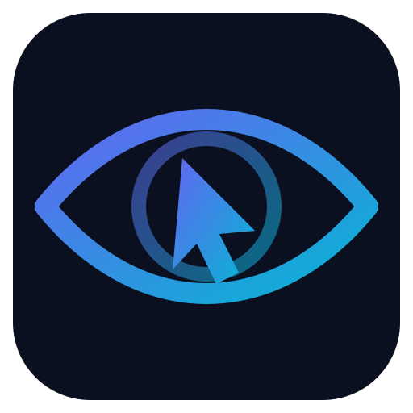

<p align="center">
  
</p>

# SimMan


[](https://www.npmjs.com/package/simman)

**[Website](https://firefly-events.github.io/simman/)** · **[npm](https://www.npmjs.com/package/simman)**

**Simulated Manual** — selectorless, vision-grounded, real-cursor testing for web.

> **Status: alpha (0.x)** — APIs and scenario schema may change between minor releases.

Instead of CSS selectors, a multimodal model is the **eyes** and a real cursor is the
**hands**: screenshot → model grounds pixel coordinates → real click → model judges
"did the expected result happen," with DOM/network truth-signals authoritative when
declared. Catches pixel/visual failures that DOM-based tools can't see.

**Model-agnostic.** SimMan is not tied to one model. We've tested primarily with
**Google Gemini** (hosted) and **Qwen2.5-VL** (local via MLX), but any capable
multimodal model that can ground coordinates from an image should work — providers are
pluggable per role (grounding / verify / synth). Grounding is the demanding job; pick a
model strong at precise spatial localization.

> Web-first. Hosted **Google Gemini** by default (zero local setup) — or run fully
> local on Apple Silicon with MLX Qwen. A Firefly Events product.

SimMan applies the same Gemini visual-grounding that powers Google's own AI pointer —
to autonomous UI testing. (We use the Gemini API directly; not affiliated with Google.)

## What works today

- **`simman run <scenario.yaml>`** — authored YAML → real browser (Playwright) →
  vision grounding → hybrid pass/fail report
- **`simman synthesize <url> "<goal>"`** — describe a goal in plain language; the
  agent explores the page and proposes a test plan, you **approve / edit / reject**
  it at the gate, and the approved plan is saved as a plain scenario YAML and run.
  Agent proposes, human disposes.
- **`simman doctor`** — preflight providers and browser
- User-defined **truth signals** — declare your app's own DOM/network ground truth
  per step (`kind: network` / `kind: element_enabled`); authoritative over the
  vision judge when declared
- Pluggable vision providers: hosted Gemini (zero-config default) or local MLX/Qwen
  (offline, Apple Silicon)

## Architecture — three layers

1. **`engine/`** — deterministic runner. Takes a **structured** scenario + overlay,
   drives the browser, vision-grounds, verifies, returns a hybrid pass/fail report.
   No LLM in the core; testable headless. _(hardened — covered by the full test suite)_
2. **`agent/`** — synthesis layer (LLM). Compiles intent into the engine's
   structured input: given a URL + a natural-language goal, explores the page,
   decomposes into steps, decides native-vs-vision, declares truth-signals.
3. **`gate/`** — approval gate. The synthesized test plan is rendered
   human-readable and **must be approved before any browser action runs**
   (approve / edit in `$EDITOR` / reject). Makes autonomous synthesis safe:
   agent proposes, human disposes.

`installer/` — local setup/doctor that makes the optional local stack (Playwright
browsers, `mlx-vlm`, Qwen2.5-VL weights, MLX sidecar) install cleanly. _(stub)_

## Prerequisites

Always:
- Node ≥ 20.19
- `npx playwright install chromium` (the browser SimMan drives)

Hosted (default — recommended for zero setup):
- `GEMINI_API_KEY` (or `GOOGLE_API_KEY`)

Local (optional — private/offline, Apple Silicon only):
- `pip install mlx-vlm` &nbsp;# vision-capable server — NOT `mlx-lm` (text-only)
- Qwen2.5-VL-7B-4bit weights (~5GB, pulled to the HF cache on first run)
- start the sidecar: `python -m engine.mlx_sidecar start` (serves on :8089)

## Quickstart

### Zero-install (npx)

```bash
export GEMINI_API_KEY=...
npx simman run scenario.yaml --base-url http://localhost:3100
npx simman doctor
```

### Global install

```bash
npm install -g simman

export GEMINI_API_KEY=...
simman run scenarios/example.yaml --base-url http://localhost:3100
simman run scenarios/example.yaml --json     # machine-readable RunReport
simman doctor                                 # preflight providers + browser

# Exit codes: 0 pass · 1 fail · 2 error
```

### From source / development

```bash
git clone https://github.com/firefly-events/simman.git
cd simman
npm install
npm link                                      # puts `simman` on PATH
npx playwright install chromium
export GEMINI_API_KEY=...
simman run scenarios/example.yaml --base-url http://localhost:3100
```

A scenario is one authored YAML — `id`, optional `baseUrl`, and `steps` of
`{ action, expected, do, truth? }`. See `scenarios/example.yaml` and
`docs/overlay-schema.md` for the compiled engine format.

### Device emulation

Use `--device WxH[@scale][,touch]` to run in a complete browser device context;
for example, `--device 390x844@3,touch`. The same value can be set as
`device` in the config file. CLI flags take precedence over config, then
`VIEWPORT_W`/`VIEWPORT_H`, then the 1280x800 desktop default. Touch contexts use
touchscreen taps and grounded coordinates remain CSS pixels at any scale.

### Signed-in browser state

Pass `--storage-state path/to/state.json`, or set `storageState` in the config,
to load Playwright authentication state. The CLI value replaces the config
value. SimMan validates the file before browser/model work and reports only its
path; cookies and local-storage tokens are never included in reports, captures,
plans, or errors.

### Request blocking

Use repeatable `--block <pattern>` flags, or a `block` array in config, to abort
matching requests before navigation. Patterns match URL substrings; `*` is a
simple wildcard, and CLI patterns replace config patterns. Blocked requests are
listed in the JSON report as `{ method, url, i, action }`, counted in the human
summary, and cannot satisfy a network truth signal. Synthesis applies the same
device, state, and block protections during exploration and approved execution.
Playwright context routing does not cover service-worker-bypassed requests or
WebSocket traffic.

Truth signals are user-defined — declare your own app's ground truth per step:

```yaml
truth:
  kind: network            # a matching request was observed…
  match: /api/posts        # …whose URL contains this
  method: POST             # optional
# or
truth:
  kind: element_enabled    # a matching element is visible + not disabled
  name: Post Now           # visible/accessible text (or selector: "<css>")
```

When declared, the truth signal is **authoritative over the vision judge** —
hybrid verification, not vibes. (The legacy `posted` / `cta_enabled` string
aliases still parse but are deprecated.)

```bash
npm test            # 219 tests — engine + cli + gate + agent, headless, no API key needed
```

## Synthesis — goal → gate → test

```bash
simman synthesize http://localhost:3100 "compose a post and publish it"
```

The agent explores the page (DOM interactables + screenshot), compiles the goal
into a structured plan, and shows it at the gate:

```
SimMan test plan — scenario "compose-post"
  1. Enter a caption
       do:     fill [data-testid="caption-input"]
       verify: the Post button becomes enabled
  2. Click Post
       do:     tapRole button "Post"   [truth: network /api/posts]
       verify: the post is submitted

gate> [a]pprove · [e]dit in $EDITOR · [r]eject:
```

Nothing touches a real cursor until you approve. The approved plan is saved to
`scenarios/<id>.yaml` — a plain, human-readable artifact that re-runs forever with
**no further LLM synthesis** (`simman run scenarios/<id>.yaml`). Use `--no-run` to
save without executing; exit code 3 means rejected at the gate.

The synthesis model is configurable per role (`synth` in `simman.config.yaml`);
synthesis quality depends on the model — hosted Gemini is the tested default.
